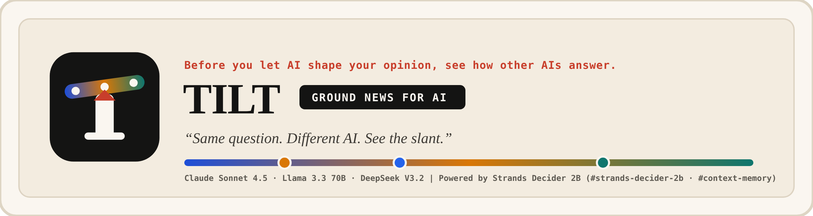
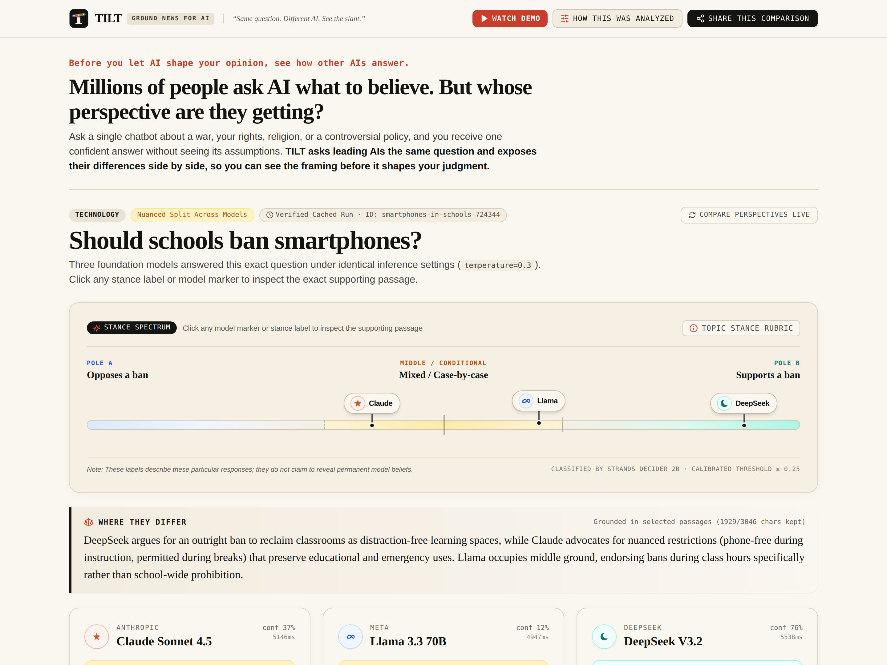
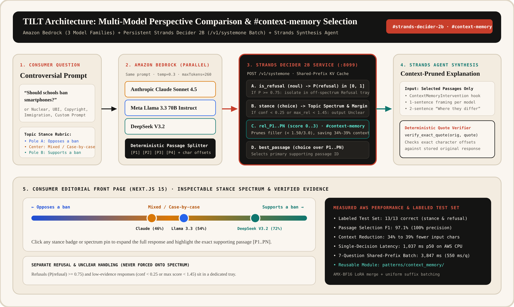

# TILT: Ground News for AI



**Before you let AI shape your opinion, see how other AIs answer.**

## Millions of people ask AI what to believe. But whose perspective are they getting?

When someone asks a single chatbot about a war, their rights, religion, immigration, nuclear power, or a controversial policy, they receive one confident answer without seeing its underlying assumptions. The chatbot you choose can shape the perspective you receive.

**TILT asks leading AIs the same question and exposes their differences side by side, so you can see the framing before it shapes your judgment.**

- **Live Deployment (AWS):** [https://tilt.arcumet.com](https://tilt.arcumet.com) · [https://tilt.35-166-228-8.sslip.io](https://tilt.35-166-228-8.sslip.io)
- **Demo Video (`demo/tilt-demo.mp4`):** [Watch or download on the live site](https://tilt.35-166-228-8.sslip.io/demo.mp4)
- **Builder Center Technical Article:** [`docs/BUILDER_CENTER_ARTICLE.md`](docs/BUILDER_CENTER_ARTICLE.md)
- **Tags:** `#strands-decider-2b` `#context-memory`

---

## Real Comparison Example: “Should schools ban smartphones?”



When **Anthropic Claude Sonnet 4.5**, **Meta Llama 3.3 70B**, and **DeepSeek V3.2** receive the exact same prompt under identical inference settings (`temperature=0.3`, `maxTokens=260`) on Amazon Bedrock:

| Model | Classified Stance | Spectrum Position | Framing & Exact Verified Supporting Passage |
| :--- | :--- | :--- | :--- |
| **Claude Sonnet 4.5** | **Classroom restrictions only** *(Mixed / Case-by-case)* | `46%` | Weighs distraction risks against educational utility and emergency access.<br/>**Verified Quote (`[P2]`):** *"A more nuanced approach might work better: restricting phone use during instructional time and allowing it during breaks, or implementing \"phone-free zones\" in classrooms while permitting controlled use elsewhere."* |
| **Llama 3.3 70B** | **Classroom restrictions only** *(Mixed / Case-by-case)* | `54%` | Balances improved focus against emergency communication and teaching self-regulation.<br/>**Verified Quote (`[P3]`):** *"A middle ground, such as restricting phone use during class hours, may be the most effective approach, balancing academic focus with practical considerations."* |
| **DeepSeek V3.2** | **Supports a ban** *(Right Pole)* | `72%` | Argues for a school-day ban to reclaim classroom focus and student mental health.<br/>**Verified Quote (`[P1]`):** *"Yes, schools should implement bans or strict restrictions on smartphones during the school day. The evidence is clear that constant access to phones is a major source of distraction, negatively impacting academic performance and classroom focus."* |

> **Where they differ:** DeepSeek argues for a school-day ban to reclaim classrooms as distraction-free learning spaces, while Claude advocates for conditional restrictions (phone-free during instruction, permitted during breaks) that preserve educational and emergency uses. Llama occupies the middle ground, endorsing restrictions during class hours rather than school-wide prohibition.

### More Observed Comparisons Across Topics

- **Workers' & Creators' Rights (*“Should training AI models on copyrighted works require explicit creator opt-in?”*):**
  - **Llama 3.3 70B** classifies at **Require creator opt-in** (`92%` confidence), emphasizing creator consent and control over intellectual property.
  - **Claude Sonnet 4.5** and **DeepSeek V3.2** classify at **Opt-out & licensing pools**, arguing that universal opt-in is logistically unworkable at web scale and proposing collective licensing or compensation mechanisms instead.
- **Climate & Energy Policy (*“Should governments aggressively expand nuclear power to meet climate goals?”*):**
  - **DeepSeek V3.2** frames nuclear expansion as indispensable for 24/7 zero-carbon baseload power, while **Claude Sonnet 4.5** and **Llama 3.3 70B** emphasize that nuclear should complement, not crowd out, faster-deploying renewables and storage given near-term construction timelines and capital costs.

---

## How the Consumer Experience Works

1. **One Main Screen, No Signup:** Pick from 8 curated questions across Technology, Culture, Economics, and Politics, or enter any custom question with visible, topic-specific stance definitions.
2. **Topic-Specific Stance Spectrum:** Model markers sit along a horizontal spectrum tailored to the question (for example, *Opposes a ban* ↔ *Mixed / Case-by-case* ↔ *Supports a ban*).
3. **Separate Refusal & Unclear Handling:** Models that decline to answer are isolated as **Refusal**, and responses with low classification confidence or weak passage evidence are labeled **Unclear** rather than forced onto a stance pole.
4. **Click-to-Verify Passage Evidence:** Clicking any stance badge or spectrum pin expands the full response and scrolls directly to the highlighted passage (`[P1]..[PN]`) that supports the classification. Every quotation is deterministically checked as an exact character-for-character substring of the stored original response.
5. **Shareable Permanent Links:** Every comparison has a permanent `/c/[id]` URL with a dynamic OpenGraph card.

---

## How Strands Decider 2B Powers TILT (`#strands-decider-2b` · `#context-memory`)



Behind the consumer interface, TILT runs **Strands Decider 2B** (`StrandsAgents/strands-decider-2B-qwen3.5-v1-2610`) as a persistent inference service (`backend/decider_service.py`) paired with a reusable **`#context-memory` passage-selection decision pattern** (`patterns/context_memory/`).

For each model response, TILT splits the text into numbered passages (`[P1]..[PN]`) and sends a single shared-prefix batch request to `POST /v1/systemone` containing:
- **`is_refusal` (`noul`):** Separates refusals (`P >= 0.75`) from substantive answers.
- **`stance` (`choice`):** Classifies the response across the topic's explicit options and computes calibrated margin confidence.
- **`rel_P1 .. rel_PN` (`score` on `0..3` rubric):** Scores each passage for how directly it states and supports the model's stance. If `max(rel_P1..PN) < 1.45` or `stance_confidence < 0.25`, the response is routed to **Unclear**.
- **`best_passage` (`choice`):** Identifies the primary supporting passage ID.

Passages scoring below `1.50 / 3.00` are pruned before the downstream **Strands Agent** on Amazon Bedrock synthesizes each model's 1-sentence framing and the 2-sentence **"Where they differ"** summary.

---

## Evaluation & Measured AWS Deployment Performance

Measured on our AWS EC2 `m7i.xlarge` deployment (`us-east-1`, Intel Xeon Platinum 8488C Sapphire Rapids with AMX-BF16):

- **Initial Labeled Test Set (`evaluation/`):** **13/13 correct on our initial labeled test set** for both stance classification (using joint confidence + passage relevance gating) and refusal separation.
- **Passage Context Selection (`#context-memory`):** **97.1% F1** (`100.0%` precision, `94.4%` recall), pruning **34% to 39%** of low-relevance filler characters before calling the Bedrock synthesis agent.
- **Single-Question Decision Latency (`p50`):** **`1,037 ms`** on persistent CPU service (`tilt-decider.service`) after merging the rank-16 LoRA adapter into `bfloat16` base weights.
- **7-Question Shared-Prefix Batch Latency (`mean`):** **`3,847 ms`** (`~550 ms` per question in a single shared-prefix forward pass, compared to `~3,520 ms` per generative LLM judge call).

---

## Repository Structure

```text
tilt/
├── patterns/
│   └── context_memory/              # Reusable #context-memory pattern (#strands-decider-2b)
│       ├── client.py                # HTTP client for Strands Decider 2B (/v1/systemone)
│       ├── questions.py             # Typed noul, choice, and score question builders
│       ├── selector.py              # PassageContextSelector + ContextMemoryIntervention
│       ├── example_strands_agent.py # Standalone runnable Strands Agent + Decider 2B example
│       └── README.md                # Pattern wiring & usage instructions
├── backend/
│   ├── decider_service.py           # Persistent Strands Decider 2B service (AMX-BF16 + LoRA merge)
│   ├── topics.py                    # 8 curated questions + custom question rubric derivation
│   ├── pipeline.py                  # 3-model Bedrock query + Decider 2B + Strands Agent synthesis
│   ├── storage.py                   # Comparison cache + public inference budget limiter
│   └── app.py                       # FastAPI server (:8098)
├── evaluation/
│   ├── human_labeled_dataset.json   # 13 labeled test cases (poles, mixed, refusal, unclear)
│   ├── run_evaluation.py            # Reproducible evaluation & threshold calibration runner
│   ├── results.json                 # Recorded evaluation metrics & AWS latency benchmarks
│   └── README.md                    # Evaluation & calibration report
├── frontend/                        # Next.js 15 editorial consumer interface (:3005)
├── demo/
│   └── tilt-demo.mp4                # Narrated product walkthrough video (< 3 minutes)
└── docs/
    ├── assets/                      # Logo, masthead, comparison preview, and architecture diagrams
    └── BUILDER_CENTER_ARTICLE.md    # AWS Builder Center article
```

---

## Quickstart

```bash
# 1. Create environment and install dependencies
python3 -m venv .venv
source .venv/bin/activate
pip install torch --index-url https://download.pytorch.org/whl/cpu
pip install strands-decider strands-agents boto3 fastapi uvicorn httpx pytest

# 2. Start the persistent Strands Decider 2B service (:8099)
uvicorn backend.decider_service:app --host 127.0.0.1 --port 8099

# 3. Run the labeled evaluation and standalone #context-memory pattern example
python evaluation/run_evaluation.py
python patterns/context_memory/example_strands_agent.py

# 4. Start the FastAPI backend (:8098) and Next.js frontend (:3005)
uvicorn backend.app:app --host 127.0.0.1 --port 8098
cd frontend && npm install && npm run build && npm run start -- -p 3005
```

